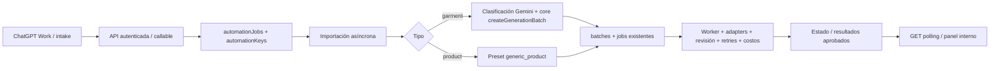

# Automatización de producción de Manglar

## Arquitectura encontrada

La app existente es React 19 + Vite + TypeScript. Las páginas coordinan hooks de features y módulos `firebase.ts`; Firebase Auth y los roles `admin`, `operador`, `revisor` protegen las rutas. `src/firebase.ts` conecta servicios reales salvo que `VITE_USE_FIREBASE_EMULATORS=true`.

El proyecto de `.firebaserc` es **tutofb-260320-1003**, con Hosting, Firebase Auth, Firestore, Storage, Functions v2/Node 22 y Scheduler. El cliente usa la base por defecto salvo `firestoreDatabaseId` en `firebase-applet-config.json`; Functions usa `getAppFirestore()` / `FIRESTORE_DATABASE_ID`. Los triggers nuevos especifican esa base. Los triggers antiguos conservan su configuración actual.

Colecciones existentes relevantes:

- `users`: usuario activo, rol y claims sincronizados por `syncClaimsOnUserWrite`.
- `clients`: cliente, prompt base y catálogo de modelos asociados.
- `models`: `clientId`, identidad humana y array `poses` con clasificación Gemini, vistas utilizables y rutas de Storage.
- `batches`: cliente/modelo, configuración de proveedor, poses y contadores.
- `jobs`: una combinación compatible de prenda/pose; reserva transaccional, timeout, estado, intentos, costo y output actual.
- `jobs/{id}/outputs`, `jobs/{id}/logs`: imágenes e historial de intentos/reviews.
- `batches/{id}/productDrafts` y `clients/{id}/spreadsheetTemplates`: exportación de catálogo, opcional para automatización.
- `system_config/main`: proveedores deshabilitados, límite de jobs/retries, modelo de revisión y prompts.
- `analytics_*`, `analytics_gemini_usage`, `finance_events`, `finance_snapshots_*`: métricas y costos.

Flujo original: `src/features/generate/storage.ts` comprime/sube originales; los hooks del wizard agrupan prendas, llaman `classifyGarmentViewsWithGemini` y eligen modelo/poses. `createGenerationBatch` valida, selecciona combinaciones compatibles y crea batch/jobs. `processJobOnCreate`, `processJobOnRequeue`, `processJobOnActivation` y el barrido programado activan `jobWorker.ts`. Este reclama mediante transacción, genera mediante adapters fal/OpenAI, ejecuta revisión Gemini y persiste outputs/costos/reintentos. La automatización usa ese mismo recorrido.

Las dependencias del frontend eran la preparación/subida de originales, la llamada de clasificación y la construcción de la solicitud al callable. Se han añadido entradas de servidor para ellas. El wizard conserva su wrapper, contrato y comportamiento.

## Implementación



- `functions/src/automation/api.ts`: HTTP y callables con autorización.
- `domain.ts`: validación, claves de idempotencia, resumen de estado.
- `persistence.ts`: creación/reintento transaccionales.
- `imports.ts`: archivos/URLs, normalización y contrato de Drive.
- `presets.ts`, `pipelines.ts`: decisiones por dominio, despacho al core/cola.
- `worker.ts`: reserva de importación, recuperación y progreso.
- `shared/src/types/automation.ts`: contratos para frontend y Functions.
- `src/features/automation/`, `src/pages/Automation.tsx`: intake y seguimiento.

### Idempotencia y recuperación

`automationKeys/{sha256("external:" + externalId)}` y, si corresponde, `automationKeys/{sha256("gmail:" + gmailMessageId)}` apuntan al mismo AutomationJob. Son globales al proyecto: usa identificadores estables con prefijo de integración/cuenta. No incluyas el timestamp del intento. La creación y las reservas de ambas claves son una sola transacción. Requests simultáneas obtienen el mismo job. Un nuevo alias que comparte Gmail se incorpora transaccionalmente al job existente. Identificadores que apuntan a dos jobs diferentes producen 409. Otro operador no puede obtener un job ajeno usando sus identificadores.

La idempotencia prevalece sobre un payload modificado: una repetición devuelve el trabajo original. Usa `/retry` para corregir una entrada detenida; usa un nuevo externalId únicamente para una producción nueva solicitada expresamente. Las claves no tienen TTL y deben conservarse.

La importación tiene una reserva de diez minutos y token. El batch, todos sus jobs y el vínculo al AutomationJob se guardan juntos en una transacción que comprueba ese token. Una entrega repetida o un worker antiguo no puede crear otro batch. El batch automático usa `automation-{automationJobId}`. Scheduler recupera pendientes/importaciones expiradas cada cinco minutos. El intake permite tres intentos en total, incluyendo recuperación de timeouts; no reinicia batches existentes.

Esto evita órdenes/batches duplicados. Como en el worker original, no hay una garantía universal de cobro exactamente una vez frente a un proveedor que complete una request y pierda la respuesta antes de la persistencia. Los reintentos externos de generación siguen sujetos a los límites existentes.

## API y autenticación

Base de Hosting:

`https://tutofb-260320-1003.web.app/api/automation`

También se puede invocar directamente:

`https://us-central1-tutofb-260320-1003.cloudfunctions.net/automationApi`

Para ChatGPT Work se utiliza la identidad técnica **chatgpt-work** con OAuth `client_credentials`, token automático de 15 minutos y acceso únicamente a `automation-e2e-test`. No necesita generar Firebase ID tokens. Configuración exacta, credenciales, almacenamiento seguro, helper HTTP, rotación y prueba real: [AUTOMATION_AUTH.md](AUTOMATION_AUTH.md).

El acceso interactivo existente conserva soporte de Firebase ID tokens y usuarios activos autorizados. Esa compatibilidad no concede roles humanos a la identidad técnica. Las rutas de negocio requieren bearer; `POST /token` requiere la credencial del cliente para emitirlo.

### Endpoints

| Método y ruta | Resultado |
| --- | --- |
| `POST /uploads` | Recibe bytes de una imagen; devuelve `{storagePath}`. No genera. |
| `POST /jobs` | Valida y crea/deduplica; 202 nuevo, 200 duplicado. |
| `GET /jobs/:id` | Estado, progreso, batch, resultados aprobados y error sanitizado. |
| `POST /jobs/:id/retry` | Corrige modelo/preset/inputs y reencola intake detenido sin batch, hasta el límite. |

Callables del frontend: `createAutomationJob` y `retryAutomationJob`, con los mismos contratos y permisos.

Errores HTTP: 400 payload, 401 token, 403 permisos, 404 recurso inaccesible/no encontrado, 409 conflicto/reintento no permitido, 500 error interno. GET no devuelve metadata de negocio, UID, rutas internas de Storage, tokens de proveedores ni prompts. Las URLs de outputs son firmadas durante 15 minutos; vuelve a consultar para renovarlas. Solo se devuelven outputs actuales con job completado y review aprobada.

### Ejemplo exacto para ChatGPT Work: archivo → prenda → polling

El orquestador obtiene los archivos por su integración autorizada con Gmail/Drive. No debe pasar enlaces de vista HTML como URLs de imagen. Ejecuta desde un entorno con HTTP autenticado y credenciales seguras:

```bash
MANGLAR_BASE='https://tutofb-260320-1003.web.app/api/automation'

UPLOAD=$(curl --fail-with-body -sS -X POST "$MANGLAR_BASE/uploads" \
  -H "Authorization: Bearer $MANGLAR_ACCESS_TOKEN" \
  -H 'Content-Type: image/jpeg' --data-binary @/ruta/segura/frente.jpg)
INPUT_PATH=$(printf '%s' "$UPLOAD" | jq -r '.storagePath')

# Usa IDs reales del cliente y del modelo de Manglar.
jq -n --arg path "$INPUT_PATH" \
  --arg clientId "$MANGLAR_CLIENT_ID" --arg modelId "$MANGLAR_MODEL_ID" \
  '{source:"gmail", externalId:"gmail:cuenta-cliente:pedido-2026-001",
    gmailMessageId:"ID_REAL_MENSAJE_GMAIL", clientId:$clientId,
    jobType:"garment", modelId:$modelId, preset:"standard",
    inputImages:[{itemId:"sku-001",fileName:"frente.jpg",storagePath:$path}],
    metadata:{orderReference:"pedido-2026-001"}}' > /tmp/manglar-job.json

CREATED=$(curl --fail-with-body -sS -X POST "$MANGLAR_BASE/jobs" \
  -H "Authorization: Bearer $MANGLAR_ACCESS_TOKEN" \
  -H 'Content-Type: application/json' --data-binary @/tmp/manglar-job.json)
JOB_ID=$(printf '%s' "$CREATED" | jq -r '.jobId')

curl --fail-with-body -sS "$MANGLAR_BASE/jobs/$JOB_ID" \
  -H "Authorization: Bearer $MANGLAR_ACCESS_TOKEN"
```

Create devuelve, por ejemplo, `{"jobId":"…","status":"pending","duplicate":false}`; los duplicados devuelven el estado actual. GET devuelve:

```json
{
  "jobId": "…",
  "status": "completed",
  "progress": {"total": 4, "completed": 4, "failed": 0},
  "outputs": [{"url": "URL_FIRMADA", "type": "hero", "metadata": {"generationJobId": "…", "itemId": "sku-001"}, "expiresInSeconds": 900}],
  "error": null,
  "batchId": "automation-…",
  "retryCount": 0
}
```

Consulta GET cada 20 segundos durante los primeros 5 minutos desde `createdAt`, y después cada 60 segundos, con timeout total de seguimiento de 30 minutos. Usa `pollAfterSeconds`, `pollingDeadlineAt` y `pollingTimedOut` de la respuesta; detente si el intervalo es cero por estado terminal o timeout. Renueva Auth si expira. Termina el polling en `completed`, `failed` o `needs_attention`; estos dos últimos requieren intervención. Un timeout de seguimiento no cancela la generación: conserva el mismo jobId. Configura la revisión de Gmail por separado en su scheduler externo (`GMAIL_CHECK_INTERVAL_SECONDS`), sin usar ese intervalo para consultar jobs. Ante un timeout de POST repite **el mismo externalId y gmailMessageId**, sin crear una nueva orden. No vuelvas a subir archivos si ya conservas sus storagePaths.

Para producto, usa `jobType:"product"`, `preset:"generic_product"`, omite `modelId` y conserva el mismo formato de inputs. Agrupa vistas del mismo artículo con el mismo `itemId`; usa distintos IDs para productos distintos. Se aceptan fotografías JPEG, PNG y WebP. Se permiten hasta 40 fotos, cuatro por artículo, menos de 10 MB por foto y 40 megapíxeles antes de normalizar. El límite efectivo de jobs sigue siendo `system_config/main.batchMaxJobs` (default 100). Cuatro escenas por artículo implican cuatro jobs y sus costos/reviews.

Para URLs HTTPS directas, sustituye `storagePath` por `url`. Solo se aceptan hosts explícitamente autorizados mediante `AUTOMATION_IMPORT_HOSTS`; no hay redirects. La resolución DNS se fija al descargar y se rechazan redes privadas/reservadas. Las descargas tienen límite de tamaño y 30 segundos. Los archivos se decodifican con sharp y normalizan a JPEG de hasta 2200 px. No se procesa HTML/SVG como fotografía.

Reintentar una entrada sin batch:

```bash
curl --fail-with-body -sS -X POST "$MANGLAR_BASE/jobs/$JOB_ID/retry" \
  -H "Authorization: Bearer $MANGLAR_ACCESS_TOKEN" \
  -H 'Content-Type: application/json' \
  --data '{"modelId":"ID_REAL_MODELO"}'
```

## Estados y datos

`pending → importing → processing/review → completed | needs_attention`.

Errores de importación/validación operativa: `failed`. Configuración ausente, clasificación insegura, Drive pendiente o jobs agotados/rechazados: `needs_attention`. `review` indica un intento con resultado aún pendiente/rechazado mientras la cola trabaja. No implica una llamada síncrona de revisión dentro de GET.

`automationJobs/{id}` guarda IDs externos, fuente, Drive URL, cliente/tipo, estado y timestamps, inputs originales en `sourceImages`, inputs preparados en `inputImages`, outputs aprobados, `batchId`, `generationJobIds`, metadata, preset solicitado/resuelto, modelo y contador/reserva de intake. Los reintentos de generación siguen en `jobs.retryCount`, `generationAttemptCount`, `autoReviewMaxAttempts` y sus logs; no se confunden con los reintentos de intake.

Los resúmenes leen los jobs actuales dentro de una transacción, evitando regresiones por orden de entrega de eventos. GET también actualiza el resumen. No recrea jobs ni ejecuta proveedores. No borrar jobs/batches manualmente para reintentar: usa los controles existentes. Si falta un job vinculado, el AutomationJob queda en atención.

## Prendas y defaults por cliente

El proveedor predeterminado de automatización es **Seedream 5 Pro** (`fal-seedream-5-pro`), tanto para prendas como para productos. Un `provider` explícito tiene prioridad, seguido del proveedor del preset del cliente y finalmente este default. La lectura de instrucciones desde correos de Work todavía no está implementada en este repositorio; el integrador debe enviar `provider` explícitamente para elegir otro modelo.

Orden de resolución: `modelId` explícito → modelo del preset del cliente → `clients/{id}.automation.defaultModelId`. Si no existe, no se elige una persona arbitrariamente.

Presets: parámetro `preset` → `automation.defaultPreset` del cliente → `standard` (prendas) / `generic_product` (productos). Un admin puede configurar en Firestore Console el mapa opcional del cliente:

```json
{
  "automation": {
    "defaultModelId": "ID_MODELO_DEL_CLIENTE",
    "defaultPreset": "standard",
    "presets": {
      "standard": {
        "modelId": "ID_MODELO_DEL_CLIENTE",
        "poseIds": ["ID_POSE_FRENTE"],
        "provider": "fal-seedream-5-pro",
        "aspectRatio": "3:4"
      },
      "generic_product": {"provider":"fal-seedream-5-pro","aspectRatio":"1:1"}
    }
  }
}
```

Sin `poseIds` se consideran las poses existentes del modelo; el core filtra las compatibles por vista/área/accesorio. No se inventan poses. Modelos y clientes archivados se rechazan. Clasificación sin área o confianza menor que 0.65, o ausencia de poses compatibles, requiere atención. La selección futura por IA puede implementarse en `resolveAutomationPreset` sin tocar la cola.

## Productos, revisión y costos

`generic_product`: una toma de fondo blanco, dos lifestyle y una hero. Es image-to-image con todas las vistas del mismo artículo (hasta cuatro), ratio default 1:1, proveedor default `fal-nano-banana-2`. El catálogo de presets es extensible en `presets.ts`; no se implementan todavía las categorías futuras ni text-to-image sin referencia.

La revisión usa el transporte/schema/registro Gemini existente, con criterios obligatorios `identity`, `colors`, `logos`, `parts`, `geometry`, `artifacts`, `scene`. No basta un verdict aprobado si falta un criterio o alguno falla. Los prompts exigen conservar forma, proporciones, colores, logos, gráficos, materiales y piezas. Los retries conservan estas reglas y la escena original.

Se usa la misma persistencia de outputs, costos por proveedor, finance triggers, analytics y logs que en el wizard. Los productos no crean un modelo humano ficticio: `generationKind:"product"`, `modelId:""`, nombre de snapshot “Producto”. La dimensión analítica sin modelo agrupa productos; totales por cliente/proveedor/finanzas los incluyen. La agrupación de métricas exclusiva de AutomationJobs no tiene un dashboard analítico nuevo.

Hasta tres intentos de review por escena (o menos si el límite configurado es menor), más los retries operativos ya configurados en el sistema. Al agotarlos el job falla y AutomationJob requiere atención. La intervención manual desde el batch puede reiniciar un job expresamente. No hay bucle automático ilimitado. Los intentos rechazados también generan costos y permanecen en el historial.

## Storage y acceso

Se conservan las convenciones existentes:

- Upload directo: `garments/drafts/{uid}/{uploadId}/upload/image.jpg`.
- Upload del intake: el helper actual `garments/drafts/{uid}/{draftId}/{garmentId}/{photoId}-{fileName}`.
- Preparados: `garments/drafts/{uid}/{automationJobId}/{itemId}/{index}.jpg`.
- Poses: `models/{clientId}/{modelId}/poses/{fileName}`.
- Outputs: `generated/{clientId}/{batchId}/{jobId}/{outputId}.{ext}`.

No se crean permisos públicos para inputs ni buckets nuevos. Las reglas existentes ya permiten lectura pública de `generated/` y el frontend usa `publicGeneratedImage`; esa política existente no cambia. La API entrega enlaces firmados de corta duración y el panel reutiliza el resolver central de Storage. No incluir datos sensibles en metadata ni secretos en URLs de fuentes si pueden evitarse; `sourceImages` se guarda solo para usuarios autorizados.

## Panel e intake

- `/automation`: últimos 100 jobs; admin ve todos, operador los propios. Fecha, cliente, fuente/tipo/estado, conteos, errores, timestamps, retry, enlaces de origen y batch, inputs/resultados.
- `/automation/intake`: cliente, tipo, modelo opcional, preset e imágenes. Por defecto cada foto es un artículo. La casilla de vistas agrupa todas las seleccionadas (máximo cuatro).
- Desde atención/fallo sin batch: reintentar o completar modelo/sustituir archivos conservando el job/identificadores. Con batch: abrir catálogo/cola y usar los controles de reintento existentes.

El frontend conserva externalId y uploads ante fallos ambiguos del submit. No automatiza clics ni replica las etapas del wizard.

## Configuración necesaria

Autenticación técnica: `MANGLAR_WORK_CLIENT_SECRET` está almacenado en Secret Manager y solo su hash en Firestore; ver `AUTOMATION_AUTH.md`. Deben seguir configurados los secrets existentes `GEMINI_API_KEY`, `FAL_KEY`, `OPENAI_API_KEY` según proveedores; los workers existentes declaran esos secrets. La importación de prendas necesita Gemini. El parámetro opcional `AUTOMATION_IMPORT_HOSTS` es una lista separada por comas de hosts HTTPS confiables que controla el operador; `disabled` por defecto desactiva descargas por URL, manteniendo los uploads directos.

API e importador limitan la concurrencia a una request por instancia para acotar el uso de memoria al decodificar fotos. Los parámetros existentes de batch, timeout, retry y review se mantienen. El despliegue de Functions inyecta defaults de Firebase Params. No editar secretos en archivos versionados. Configurarlos mediante `firebase functions:secrets:set NOMBRE --project tutofb-260320-1003` cuando sea necesario. Requiere los permisos de firma de URL ya usados por el worker actual.

## Drive y callbacks (P2)

Existe `functions/src/google/drive.ts`, pero sirve para **exportar spreadsheets** mediante cuenta de servicio/configuración de carpeta. No es prueba de acceso a carpetas entrantes de clientes. No se reutilizan sus credenciales para enumerar arbitrariamente enlaces externos.

`DriveImportAdapter.importImages(driveUrl, job)` es la interfaz preparada. El adapter por defecto deja el trabajo en atención y permite el fallback manual. Para completarlo falta acordar una de estas autorizaciones: compartir las carpetas entrantes con una cuenta de servicio, o una integración OAuth Drive con consentimiento, almacenamiento/renovación de tokens y acceso mínimo a los archivos correspondientes. El adapter debe usar Drive API v3, listar con paginación/límites, descargar medios con autenticación, respetar shared drives y convertir cada vista a un `AutomationInput` autorizado. Debe definir cómo agrupar artículos, no inferirlo por scraping HTML. No hay credenciales personales ni scraping de links.

`driveUrl` solo conserva contexto en esta versión. ChatGPT Work puede descargar mediante su integración de Drive y mandar bytes a `/uploads`; no necesita que Manglar tenga OAuth Drive. Callbacks no están implementados ni se aceptan como mecanismo funcional: usar polling. No se envían correos ni notificaciones externas.

## Pruebas locales

```bash
npm run lint
npm --prefix functions run lint
npm test
npm run build

# Pruebas reales de persistencia, API y worker contra proyecto demo aislado.
# No emular Functions en este comando: los tests invocan los handlers y simulan proveedores.
firebase emulators:exec --project demo-manglar-automation \
  --only auth,firestore,storage \
  'node --import tsx --test tests/automation.integration.test.ts'
```

La suite normal omite el test de integración sin las tres variables de emuladores. No hace requests a proveedores. La integración verifica autenticación y usuario inactivo, payload inválido, subida/validación de archivos, idempotencia concurrente y aliases, aislamiento de lecturas/reglas, despacho de prendas/productos, reservas expiradas, intentos limitados, revisión, persistencia de costos y finalización. Usa Auth/Firestore/Storage emulados y proveedores/Gemini simulados. No es una validación visual de fidelidad de un modelo comercial real.

Para desarrollo del frontend contra emuladores:

```bash
firebase emulators:start --project demo-manglar-automation --only auth,firestore,storage,functions
VITE_USE_FIREBASE_EMULATORS=true npm run dev
```

Crear usuario activo/cliente/modelo de prueba en los emuladores. Una generación real requiere secretos y referencias accesibles al proveedor externo; los tests usan adapters simulados para evitar costos. `npm run dev` sin el flag **usa Firebase real**.

## Despliegue

```bash
npm run lint
npm --prefix functions run lint
npm test
npm run build
firebase deploy --project tutofb-260320-1003 --only functions,firestore:rules,firestore:indexes,hosting
```

En el primer despliegue, Firebase CLI solicita el parámetro `AUTOMATION_IMPORT_HOSTS`; aceptar `disabled` en una terminal interactiva. La CLI guarda la configuración no secreta del parámetro; después se puede usar `--non-interactive`.

El cambio de Hosting añade el rewrite `/api/automation/**` antes del SPA fallback. No cambia proyecto/targets, proveedores, roles o estados de jobs/batches existentes; solamente añade estados propios del AutomationJob e índice de listado por creador/fecha. No necesita desplegar Storage rules porque no se modifican. Desplegar todas las Functions incluye los triggers de worker que importan código compartido modificado y los callables de regeneración.

Después del deploy, la prueba sin credenciales debe devolver 401, no iniciar generación:

```bash
curl -i https://tutofb-260320-1003.web.app/api/automation/jobs/test
```

La identidad técnica y su secreto ya están provisionados; falta vincular su secreto al almacén seguro de la herramienta HTTP de Work. Una primera orden real debe usar un cliente/modelo autorizado y conlleva costos normales de generación/revisión. Mantener observación de logs estructurados `automation job created`, `duplicate ignored`, `import started/completed`, `generation started/completed`, `review failed`, `retry`, `job completed/failed/needs_attention`. No se imprimen tokens ni URLs firmadas desde los nuevos logs de automatización.

## Inventario de cambios

Nuevos: `functions/src/automation/{api,domain,imports,persistence,pipelines,presets,worker}.ts`, `shared/src/types/automation.ts`, `src/features/automation/{firebase,useAutomation}.ts`, `src/pages/Automation.tsx`, `tests/automation.test.ts`, `tests/automation.integration.test.ts` y este documento.

Adaptados: `functions/src/callables/createGenerationBatch.ts` (core reusable/reserva atómica), `classifyGarmentViewsWithGemini.ts` (clasificador exportado), `regenerateJob.helpers.ts` (prompt de producto), `retryJobAutoReview.ts` (revisión manual de producto con sus referencias), `functions/src/providers/{types,fal,openai}.ts` (referencias múltiples opcionales), `functions/src/review/geminiImageReview.ts` (criterios de producto), `functions/src/workers/jobWorker.ts` (referencias/review/retry de producto), `functions/src/index.ts`, `shared/src/types/{index,client,batch,job}.ts`, `src/app/AppRouter.tsx`, `src/components/layout/navigation.ts`, `src/components/ui.tsx`, `firebase.json`, `firestore.rules`, `firestore.indexes.json` y `README.md`.

Los cambios locales que ya existían en router, error boundary y generación de modelos se conservaron. No se modificaron dependencias/lockfiles ni se hicieron commits/pushes.

Referencias oficiales de las garantías utilizadas: [verificación de ID tokens](https://firebase.google.com/docs/auth/admin/verify-id-tokens), [revocación de sesiones](https://firebase.google.com/docs/auth/admin/manage-sessions) y [entrega y orden de triggers Firestore](https://firebase.google.com/docs/functions/firestore-events). La idempotencia y las reservas son necesarias porque los eventos pueden repetirse y no tienen orden garantizado.

## Verificación realizada el 16 de octubre de 2026

- Typechecks frontend y Functions: correctos.
- Build frontend y Functions: correctos.
- `npm test`: 76 pruebas aprobadas, cero fallos; la integración se omite sin emuladores.
- Integración en Auth/Firestore/Storage del proyecto demo: 15 pruebas aprobadas, cero fallos, con proveedores simulados. Incluye el callable del wizard manual y la revisión manual de productos.
- API publicada: GET sin token devuelve `401 unauthenticated` tanto en Hosting como en la URL directa de Functions.
- Ruta de intake sin sesión: redirige a login.

La verificación inicial usó proveedores simulados. La prueba real posterior de la identidad técnica sí ejecutó generación y revisión: ver [AUTOMATION_AUTH.md](AUTOMATION_AUTH.md) y [AUTOMATION_E2E_RESULT.json](AUTOMATION_E2E_RESULT.json).

Despliegue completado en `tutofb-260320-1003`: Functions (incluidos worker y revisión manual), reglas e índice de Firestore y Hosting. `AUTOMATION_IMPORT_HOSTS=disabled` quedó configurado por Firebase CLI. No se modificaron Storage rules, dependencias ni credenciales de proveedores.
